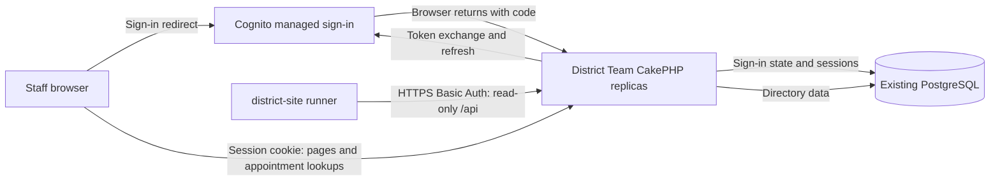

# District Team authentication

* **Author:** Jacob Tyler
* **Status:** Draft
* **Date:** 2026-11-18

## Overview

District Team will require Cognito sign-in for its browser interface. Access will depend on membership in the Cognito group for the deployment environment. Staff will continue to use the appointment forms after signing in, and the district-site build will continue to read directory data from the API on internal Kubernetes GitHub runners.

## The Problem

District Team has no application-level authentication for its directory and editing screens or its read-only JSON API. Staff use the API from within the appointment forms to find members and load their contact methods. The district-site build also uses the API to generate site content. Requiring a browser sign-in for every request would interrupt the build, and requiring build credentials for every API request would interrupt the appointment forms. Both workflows need to keep working once authentication is enforced.

## Goals

* Require a valid Cognito-backed session and membership in the exact `district-team-{env}` group to access the browser app. Sign-in and active sessions must work across Kubernetes replicas and during a rollout.
* Keep member search and contact-method lookup working in the appointment add and edit forms using the staff member's browser session.
* Allow the district-site build to read the API using a dedicated HTTP Basic Auth credential over HTTPS. Preserve the existing response schemas. Verify successful access and rejection of missing or invalid credentials on the internal runner path before enforcing authentication in production.
* End access after group removal at the next scheduled session revalidation or expiry. Give operators a way to invalidate a person's sessions across replicas and revoke their refresh tokens when access needs to end sooner.

## Non-Goals

* Write access through the JSON API.
* Local user provisioning and additional browser roles.
* Cognito machine-to-machine JWTs or multiple machine credential schemes in the first release.
* Changes to district-site's rules for publishing directory data.

## Open Questions

* Confirm other machine consumers and their required routes before granting credentials or retiring the previous appointment lookup URLs.
* Confirm the proposed group revalidation interval and sign-in transaction lifetime. Confirm the owners for group membership, session revocation, and build credential rotation.

## Critical User Journeys

### Staff member edits an appointment

* **Given** a staff member belongs to the deployment's Cognito group.
* **When** they sign in, open the add or edit form, and select a member.
* **Then** either pod can serve the request, and the form can search for members and load contact methods with the browser session.

### District-site builds on its internal runner

* **Given** the target API enforces Basic Auth and the build has its environment's credential.
* **When** the existing GitHub Actions build reads directory data over HTTPS.
* **Then** approved API requests return the existing JSON payloads and the static export completes. Missing or invalid credentials return a JSON HTTP 401 without a sign-in redirect.

### An operator removes browser access

* **Given** the user has active sessions.
* **When** the user loses group membership, or an operator revokes access urgently.
* **Then** routine removal takes effect at the next revalidation or expiry. Urgent revocation invalidates existing sessions across pods and revokes their refresh tokens. Network access can also be withdrawn where applicable.

## Technical Plan

### Browser sign-in and authorization

Use the DistrictBadges CakePHP flow as a reference for sign-in, logout, and token refresh. Add explicit sign-in, callback, and logout routes and enforce the browser policy centrally after routing. Keep the login entry points, required static assets, and infrastructure health check reachable. The configured environment determines the exact required group, so a deployment with missing auth configuration fails closed. Display access-request guidance when valid Cognito credentials lack the group.

The sign-in start stores a short-lived OAuth state value, nonce, PKCE verifier, and validated local return path. The callback consumes that state once, exchanges the code with Cognito, and validates the ID token signature, issuer, app client audience, token use, expiry, and nonce. The callback checks the required group before creating a session and rotates the session ID on sign-in. Cache Cognito signing keys by issuer and handle key rotation. Retain server-side CSRF protection for browser state changes, including logout. Logout clears the local session and ends the Cognito browser session.

### Shared session storage and revocation

Use a dedicated table in the existing PostgreSQL database. Both app replicas read and write sign-in state and authenticated sessions in this store. The browser receives an opaque session ID in a Secure, HttpOnly cookie with SameSite=Lax so Cognito's top-level callback can carry it. Store session expiry, revalidation time, the Cognito subject, and protected refresh-token material server-side. Index authenticated sessions by Cognito subject so operators can locate all sessions for one person. Expired sessions and temporary sign-in state are removed on a regular schedule.

At scheduled revalidation, the app refreshes tokens and checks the required group again. Serialize refresh for a session so concurrent requests use the current token, including when Cognito rotates it. Expiry, a missing group, or a rejected refresh ends access. If required revalidation is unavailable, the app denies access until it can verify authorization. Urgent revocation invalidates all matching local sessions first and revokes their Cognito refresh tokens. Make revocation retryable and prevent an in-flight refresh from restoring a revoked session. Operators can also withdraw WireGuard or firewall access where applicable.

### Appointment lookups and the machine API

Move the appointment lookups to explicit GET routes under the browser scope, using `/appointments/lookup/members` and `/appointments/lookup/contact-methods` as the proposed URLs. Change the add and edit forms to point to those routes. Preserve their query parameters and JSON response shapes. The lookup handlers use the same session and group checks as the appointment screens and return JSON errors when the session cannot authorize the lookup. Coordinate retirement of the two old `/api` URLs with any callers found in the inventory.

Apply a separate Basic Auth policy to the CakePHP `Api` route prefix. Validate credentials against the target environment and grant the build access to its approved read-only routes. The district-site fetch helper currently reads teams, roles, group teams, group roles, members, and appointments. Verify the full build against this route list before granting access. Return JSON HTTP 401 with a Basic challenge for missing or invalid credentials and HTTP 403 for a valid client requesting a route outside its grant. Keep API response schemas intact. Pass the credential from GitHub Actions secrets to the server-side build fetch helper and provision the corresponding verifier through the environment's Kubernetes secret mechanism.

### Rollout and recovery

Prepare the session migration, environment groups, Cognito callback settings, and build credentials before enforcement. Test the actual district-site build against the test overlay with authentication enforced, using the internal runner and the deployed HTTPS path. Check valid and invalid requests, cross-pod sign-in and logout, group removal, and the generated site artifacts. Apply the production change only after these checks pass. Repeat the build after cutover and credential rotation. Use a protected release or verified deployment configuration for rollback.

Record sanitized authentication outcomes and request IDs for operator triage. Keep authorization headers, credentials, tokens, callback secrets, and member data out of authentication logs. Keep the build credential out of caches and published artifacts.

## Alternatives Considered

### Cognito machine-to-machine access tokens

A separate Cognito app client could exchange its client ID and secret for short-lived access tokens with scopes. That would support finer grants if more integrations need different access. It adds an app client, token exchange and validation, and AWS token request costs. The author approved Basic Auth for the first release because the known machine consumer is one internal build. [AWS Cognito machine-to-machine authorization](https://docs.aws.amazon.com/cognito/latest/developerguide/cognito-user-pools-define-resource-servers.html)

### Keep the two appointment lookups under /api

Explicit per-route rules could preserve the two URLs and accept the browser session for those lookups. This would put session and Basic Auth routes under the same prefix and make their credential rules less apparent. The author chose to move the lookups into the browser scope. A blanket Basic Auth rule on the existing routes would break the forms unless the browser also received a machine credential, which would expose that credential.

### Require a local user record

A local user record, as in DistrictBadges, could support local roles and application-specific attribution. It would introduce provisioning and require operators to maintain local access records alongside Cognito membership. The author chose the exact environment group as the browser access rule. Local user records can be revisited if local roles or attribution become requirements.

### Store sessions in shared Redis

Redis could isolate session traffic from PostgreSQL and expire session records automatically. It would add a service dependency and still require a per-user index for revocation. An outage or eviction of active records could interrupt browser access. The author chose the existing PostgreSQL database, accepting the extra database work in exchange for reusing the current service and migration process.

## Non-Functional Requirements

* Protect member data and secrets in transit and at rest. Keep authentication responses and protected directory responses out of shared HTTP caches. Keep the machine credential and refresh tokens out of diagnostics and generated site artifacts.
* Keep authentication independent of a particular pod. Bound outbound Cognito timeouts and make database or Cognito failures at required revalidation deny access. Keep the machine API independent of Cognito availability.
* Maintain a protected rollback release. The unauthenticated application image predates enforcement and cannot serve as the rollback target unless an independent guard demonstrably protects both the browser and API surfaces.

## Detailed Implementation Plan

Paths below are relative to this repository. Paths beginning with `../district-site/` belong to the site repository. New filenames are proposed. Use the next available migration timestamp when the change is implemented.

1. **Configure Cognito and the app.** The Cognito operator provisions the exact environment groups and membership and configures an authorization-code app client with token revocation enabled. Register each deployment's exact callback and post-logout URLs. Coordinate these settings with the existing Cognito owner. In [config/app.php](../../config/app.php), read the required deployment environment, pool ID, managed sign-in domain, client ID, and client secret for a confidential client. Derive URLs from the configured canonical application origin. Add session-cookie and timeout settings, an app-specific refresh-token encryption key, and the configuration for per-consumer Basic Auth verifiers. Show names and development setup in [config/app_local.example.php](../../config/app_local.example.php) without embedding credentials. Use a 90-minute idle timeout and a 24-hour absolute session limit. The proposed sign-in transaction lifetime is 10 minutes, with group revalidation on the first protected request after 30 minutes or at ID-token expiry, whichever comes first. Verify provider settings support those windows. [AWS refresh token documentation](https://docs.aws.amazon.com/cognito/latest/developerguide/amazon-cognito-user-pools-using-the-refresh-token.html)
2. **Persist sessions and implement revocation.** Create `config/Migrations/<timestamp>_CreateAuthSessions.php` and `src/Model/Table/AuthSessionsTable.php`. Key rows by a digest of the opaque browser session ID. Store the pending OAuth transaction and its expiry, or the authenticated subject, sign-in time, last activity, revalidation deadline, token expiry, encrypted refresh token, and revocation status. Index subject and expiry. Enable atomic consumption of pending sign-in state and rotation to a new session ID. In `src/Service/AuthSessionService.php`, apply expiry and refresh rules, serialize refresh and revocation on the affected rows, and recheck state inside the lock. Persist any rotated token before releasing the lock. Bound the Cognito call while holding a lock. Mark sessions revoked before attempting remote revocation. Retain encrypted token material on failed remote revocation for retry, then remove it on success or token expiry. Add `src/Command/RevokeAuthSessionsCommand.php` to revoke sessions by Cognito subject using the deployment's existing operator access. Add `src/Command/PruneAuthSessionsCommand.php` to remove expired rows in bounded batches and retry pending revocations. Schedule it through `K8S/base/app/auth-session-maintenance-cronjob.yaml` and include the resource in [K8S/base/kustomization.yaml](../../K8S/base/kustomization.yaml).
3. **Add browser entry points and authorization.** Create `src/Service/CognitoService.php` for authorization-code exchange, refresh, cached signing keys, token checks, and token revocation, using the DistrictBadges implementation as a reference. On refresh, check the verified subject matches the session and recheck the exact group. Use Cognito's token revocation endpoint per session so the command revokes the affected app's refresh tokens. Create `src/Controller/AuthController.php` for sign-in, callback and CSRF-protected POST logout. Add `templates/Auth/login.php` and `templates/Auth/access_denied.php`, and add a logout form to [templates/layout/default.php](../../templates/layout/default.php). In [config/routes.php](../../config/routes.php), define GET `/auth/login`, GET `/auth/callback`, and POST `/auth/logout` explicitly. Add `src/Middleware/BrowserAuthMiddleware.php` and register it in [src/Application.php](../../src/Application.php) after routing and within the existing CSRF-protected pipeline. Give explicit exemptions to login and callback, and preserve infrastructure probes and static asset handling. Return a sign-in redirect for protected pages with no session, a 403 for insufficient group access, and JSON errors for the two lookup routes. Verify generic fallback routes cannot expose an exempt action through another path. [AWS token revocation endpoint](https://docs.aws.amazon.com/cognito/latest/developerguide/revocation-endpoint.html)
4. **Move appointment lookup actions.** In [config/routes.php](../../config/routes.php), add GET-only `/appointments/lookup/members` and `/appointments/lookup/contact-methods`. Move the handlers from [src/Controller/Api/MembersController.php](../../src/Controller/Api/MembersController.php) and [src/Controller/Api/MemberContactMethodsController.php](../../src/Controller/Api/MemberContactMethodsController.php) into a new `src/Controller/AppointmentLookupsController.php` under the browser policy. Preserve existing validation, query parameters, filtering, and JSON payloads, and reuse the current model queries. Remove the two API route registrations once the consumer inventory clears their retirement. Change [templates/Appointments/add.php](../../templates/Appointments/add.php) and [templates/Appointments/edit.php](../../templates/Appointments/edit.php) to use the new URLs. The browser helpers already read the URLs from the forms.
5. **Enforce machine authentication.** Create `src/Middleware/ApiBasicAuthMiddleware.php` and attach it to the entire routed `Api` prefix in [config/routes.php](../../config/routes.php), including extension variants. Require HTTPS at the proxy boundary. Verify the environment-specific username and secret against a stored verifier. Allow the district-site credential only the GET collection routes for teams, roles, members, and appointments and the two group collection routes. Return a Basic challenge and JSON 401 for absent or invalid credentials, and JSON 403 when a valid credential lacks a grant. Configure the server to accept old and new verifiers during credential rotation and remove the old verifier after the replacement build passes. Ensure the browser cookie is never accepted as API authentication.
6. **Wire the deployment and the build.** In [K8S/overlays/test/config-map-patch.yaml](../../K8S/overlays/test/config-map-patch.yaml) and [K8S/overlays/prod/config-map-patch.yaml](../../K8S/overlays/prod/config-map-patch.yaml), supply the deployment environment and public Cognito settings. Supply sensitive settings through the existing per-environment 1Password items and Secret references. In [K8S/base/config/nginx-config-map.yaml](../../K8S/base/config/nginx-config-map.yaml), ensure the TLS-facing FastCGI location passes the Authorization header to PHP and omits auth callback query strings from access logging. Apply the same settings in [K8S/overlays/test/nginx-config-map-patch.yaml](../../K8S/overlays/test/nginx-config-map-patch.yaml) and [K8S/overlays/prod/nginx-config-map-patch.yaml](../../K8S/overlays/prod/nginx-config-map-patch.yaml), which replace the nginx configuration. In [../district-site/.github/workflows/deploy.yml](../../../district-site/.github/workflows/deploy.yml), inject `DISTRICT_TEAM_API_USERNAME` and `DISTRICT_TEAM_API_PASSWORD` from the selected GitHub environment's secrets into the build step. In [../district-site/src/lib/district-team.ts](../../../district-site/src/lib/district-team.ts), validate HTTPS and the credentials before fetching, send Basic Auth only to the configured endpoint, reject redirects, and avoid shared caching of authenticated responses. Keep missing credentials and upstream 401 or 403 actionable build failures. Document the variables in [../district-site/.env.example](../../../district-site/.env.example) and [../district-site/README.md](../../../district-site/README.md).
7. **Update the contracts and operational instructions.** In [API.md](../../API.md) and [config/schema/openapi.json](../../config/schema/openapi.json), document Basic Auth, challenge and denial responses, and the two lookups moving to the browser scope. Preserve the read-only machine API's response definitions. In [K8S/README.md](../../K8S/README.md), document group provisioning, the environment mapping, OnePassword fields, maintenance schedule, and commands for migration, revocation, and credential rotation. Record the production gate and rollback release. In [README.md](../../README.md), document local sign-in and API credential setup. Before production, the release operator confirms consumer inventory, named owners, and the proposed revalidation and sign-in timings.
8. **Add regression tests.** Create `tests/TestCase/Service/CognitoServiceTest.php` for claim validation, invalid nonce handling, signing-key rotation, refresh results, and revocation errors. Create `tests/TestCase/Service/AuthSessionServiceTest.php` for consume-once state, expiry, ID rotation, shared PostgreSQL access, refresh concurrency, and revocation retries. Create `tests/TestCase/Controller/AuthControllerTest.php` and `tests/TestCase/Controller/AppointmentLookupsControllerTest.php` for allowed and denied browser flows, callback replay, logout CSRF, and lookup payload parity. Update [tests/TestCase/Controller/AppointmentsControllerTest.php](../../tests/TestCase/Controller/AppointmentsControllerTest.php) for authenticated forms and new URLs, and [tests/TestCase/Controller/Api/ApiControllerTest.php](../../tests/TestCase/Controller/Api/ApiControllerTest.php) for allowed clients, denied credentials, route grants, old lookup retirement, and response parity. Add `tests/Support/AuthenticatedSessionTrait.php` to seed scoped authenticated sessions. Adopt it for existing authenticated requests in `tests/TestCase/ApplicationTest.php` and in `tests/TestCase/Controller/IndexFiltersTest.php` and `tests/TestCase/Controller/{CoreData,EmailGroups,Groups,Imports,MemberContactMethods,Members,Pages,Roles,Tags,Teams}ControllerTest.php`. Keep tests that exercise public or denied entry points explicitly unauthenticated. Update [../district-site/tests/unit/lib/district-team.test.ts](../../../district-site/tests/unit/lib/district-team.test.ts) for authorization headers, configuration failures, redirect rejection, and pagination with credentials.

### Verification and release

* Run District Team's `composer check` for PHP tests, lint, static analysis, and OpenAPI lint. Run `yarn test:run` in district-site and its normal build verification.
* Apply the additive migration before authenticated app pods receive traffic. On the test overlay, exercise sign-in start and callback on different replicas, AJAX lookups, logout, group loss on refresh, and operator revocation while a refresh is in flight. Verify that the app denies protected requests after the applicable deadline.
* Run the full district-site build on `lbdistrictscouts-runners` against the protected test hostname. Verify all needed collection requests, JSON 401 and challenge for missing or invalid credentials, 403 outside the grant, and the generated site's existing publication rules. Check logs and artifacts for credential disclosure.
* After the protected test run passes, deploy the production migration and app, then repeat the production build and authorization checks. If an authorized build fails or a denied request succeeds, stop the rollout, restore the last verified protected setup or block affected routes until recovery, and rerun verification before reopening access. Repeat the runner build after rotation.

*Drafted with EGM*
